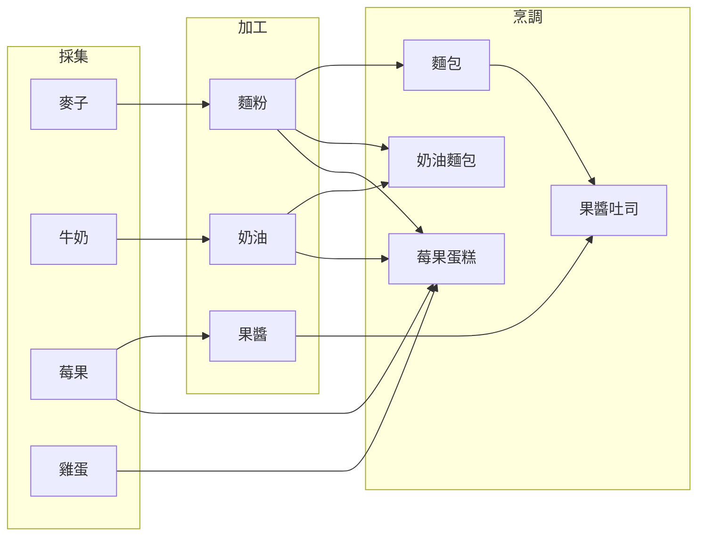
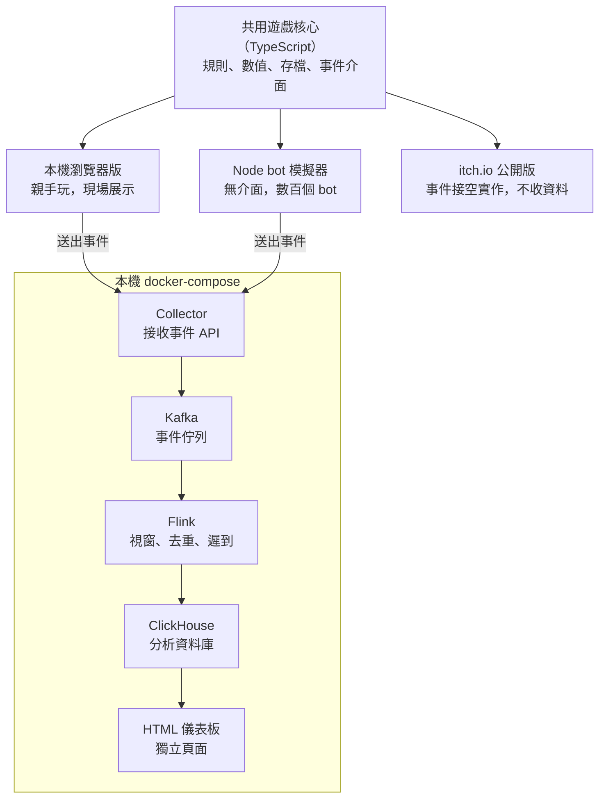

# Rise & Slime（史萊姆麵包坊）：遊戲與串流資料 Side Project 設計

Oct 29, 2026 · @Po

## 專案目標

用一款放置型小遊戲產生事件流，搭一條即時資料管線和分析儀表板，補上串流資料這個弱項，並做成求職作品集。

- **補弱項**：目前經歷以批次處理為主（Airflow、PySpark、Databricks、BigQuery），缺少 Kafka、串流處理的實作經驗
- **作品集**：招募方能玩到遊戲、看到架構、讀到分析成果
- **成品形式**：一款公開的遊戲、一個一行指令就能跑起來的 repo、個人網站上的詳細專案報告（HTML，可放互動圖表和儀表板畫面，形式比照 Stark 專案頁），以及一篇為報告引流的 Medium 精簡文章

面試時可以接上 Momotaro 的經驗，講成一個故事：從批次的事件追蹤，進化到即時處理。

## 已定決策

| 項目 | 決定 | 影響 |
| --- | --- | --- |
| 主要目的 | 求職作品集 | 真正的作品是報告與文章，不只是程式碼 |
| 時程 | 不設時限，慢慢做 | 每個里程碑都要是能拿出來展示的完整版本 |
| 部署 | 本機 docker-compose | 免費；靠 README、架構圖和儀表板動圖展示 |
| 玩家 | 只用 bot 模擬 | 資料量可以自己調；bot 要有不同玩法人格 |
| 版本 | itch.io 公開版（不收資料）＋本機展示版（記錄資料） | 只寫一套遊戲核心，事件發送做成可抽換模組 |
| 主題 | 史萊姆麵包坊，英文名 Rise & Slime（副標 A Slime Bakery Idle Game）；商品可廣義延伸到料理、餐點 | 生產鏈本身就像一條資料管線 |
| 崗位分配 | 前期手動，中期解鎖「史萊姆店長」自動分配 | 前期有玩家決策可分析，店長解鎖價格可做 A/B |
| 前端 | 從 M1 就做完整畫面，像素風，介面全英文 | 需要素材、音樂、音效與中文像素字型 |
| 素材授權 | 以 CC0 為主，所有素材一律標註作者 | 可直接放進公開 repo；標註寫在 CREDITS.md、遊戲製作名單、itch.io 頁面 |
| 分工 | 這份文件負責設計，實作在 Claude Code 與 GitHub 專案進行 | 文件即實作規格書 |

## 遊戲設計

玩家養史萊姆，讓牠們在生產鏈上工作做麵包，開店賣錢，再用錢擴張。

**生產鏈**（每一站由史萊姆負責）

1. 種麥
2. 磨粉
3. 烘焙
4. 上架販售

**史萊姆**

- 可以合成升階
- 偶爾出現變異，帶來特性，例如火屬性烤得快、黏黏型搬得多但走得慢
- 特性決定「誰適合哪個崗位」

**經濟與成長**

- 麵包賣錢，錢拿去買新配方、擴建工作站、孵新史萊姆
- 後期加入每日訂單與浮動價格

**商品範圍**：不限於麵包。史萊姆世界觀下可以廣義延伸到烘焙、食材、料理、餐點；M1 先做麥、粉、麵包這條鏈，M4 的新配方再擴展到其他料理。

**客人**：隨機的可愛小怪物在店門口走動、進店購買。M1 販售自動進行，客人只是視覺效果；M4 加入訂單後，客人可以對應到訂單和購買事件。

**轉生**：開分店，原本的店歸零，換取永久加成。

**崗位分配**

- 前期：玩家手動把史萊姆分配到各站，學會生產鏈怎麼運作
- 中期：花錢解鎖「史萊姆店長」，自動分配，玩家只選策略（產量優先、特性優先、平均分配）
- 「從手動到自動」本身就是放置遊戲的核心成就感

## 數值設計（M1）

M1 的最佳分配是種麥、磨粉、烘焙 4 : 6 : 5，此時每秒產 1 個麵包、賺 10 金幣。所有數值都是起點，實作後用 bot 模擬校正。來源分三種：**慣例**有業界前例可循，**推算**由其他數值算出，**暫定**是設計選擇、可以放心調。

**生產鏈**

| 站 | 每隻史萊姆的工作 | 每次耗時 | 來源 |
| --- | --- | --- | --- |
| 種麥 | 產出 1 麥 | 1 秒 | 暫定 |
| 磨粉 | 2 麥 → 1 粉 | 3 秒 | 暫定 |
| 烘焙 | 2 粉 → 1 麵包 | 5 秒 | 暫定 |

耗時刻意挑成不直觀的比例，讓分配不均時一定有站點堆積。M1 的販售自動進行，不佔崗位。

**經濟與成本**

| 項目 | 數值 | 來源 |
| --- | --- | --- |
| 麵包售價 | 10 金幣，固定 | 暫定 |
| 最佳分配 | 4 : 6 : 5 | 推算：上下游消耗剛好相等 |
| 開局狀態 | 每站各 1 隻史萊姆，送 20 金幣 | 暫定（另一個選項：第一隻新史萊姆降到 10 金幣） |
| 新史萊姆成本 | 20 × 1.15^n，n 為累計購買數（見「合成與變異」的防洗價規則） | 成長率 1.15 為慣例（Cookie Clicker）；基礎價 20 暫定 |
| 工作站升級 | 每級速度 +10%，成本 50 × 1.12^等級，各站分開計算 | 成長率落在慣例範圍 1.07–1.15；數值暫定 |
| 里程碑倍率 | 每站 10、25、50 級時速度 ×2 | 慣例（AdVenture Capitalist）；門檻暫定 |

參考：Anthony Pecorella 在 Kongregate 發表的《The Math of Idle Games》系列，整理了放置遊戲常見的成本成長率與里程碑設計。

**節奏目標**（暫定）

- 10 秒內買到第一隻新史萊姆
- 5 分鐘內遇到第一次明顯的瓶頸
- 30 到 60 分鐘進入停滯期，之後由轉生接上

驗算紀錄：開局每站各 1 隻時瓶頸在磨粉，收入約每秒 1.7 金幣，第一個麵包約 13 秒出爐。若不送開局金幣，約 20 秒才買得起第一隻新史萊姆，達不到 10 秒目標，所以加上開局 20 金幣。

成本指數成長、產出接近線性，差距越拉越大，玩家自然放慢，形成轉生的動機。升級會改變各站速度，最佳比例和瓶頸也跟著移動，這讓即時儀表板有東西可看。

## 合成與變異（M3）

3 隻同階史萊姆合成 1 隻高一階，合成時有 5% 機率變異；搭配工位上限，讓「現在合成，還是先擴建」成為真正的決策。

**工位上限**：每站一開始 10 個工位，可花錢擴建（暫定）。沒有上限的話，一直買就好，合成沒有意義。

**合成規則**

| 項目 | 數值 | 來源 |
| --- | --- | --- |
| 合成條件 | 3 隻同階 → 1 隻高一階 | 慣例（合成類遊戲最常見的 3 合 1） |
| 階級倍率 | 2.5^(階級−1) | 暫定 |
| 合成損益 | 總效率損失約 17%（3.0 → 2.5），省下 2 個工位 | 推算 |

**防洗價規則**：新史萊姆成本公式 20 × 1.15^n 的 n 改為**累計購買數**，不是目前擁有數。否則合成會讓 n 變小，玩家可以靠「買、合、再買」無限壓低價格。

**變異**

- 觸發：合成時 5% 機率（暫定）
- 繼承：合成材料中有變異的，結果隨機繼承其中一種特性

| 變異 | 擅長 | 不擅長 |
| --- | --- | --- |
| 草葉型 | 種麥 +50% | 烘焙 −20% |
| 石殼型 | 磨粉 +50% | 種麥 −20% |
| 火焰型 | 烘焙 +50% | 磨粉 −20% |
| 幸運型 | 合成時變異機率 ×2 | 無 |

數值皆為暫定。每種變異都有「放錯位置會吃虧」的設計，店長的「特性優先」策略才有意義。幸運型會讓實際變異率偏離 5%，用來展示分析資料品質時要先排除已知的干擾因素。

**資料面變化**：史萊姆多出階級、特性欄位，並新增合成事件，這是 M3 要展示的 schema 演進。

## 原料與配方（M4）

M4 把生產鏈從一條線擴充成一張網：同一種中間材料會被好幾個配方搶著用，玩家得決定優先做什麼。M1 維持麥 → 粉 → 麵包一條線，先把管線跑通。



麵粉同時供應麵包、奶油麵包和莓果蛋糕，奶油也被兩個配方共用；這和 Airflow DAG 的分流、匯入是同一種結構。

**產品變化的三個來源**

1. **原料組合**：不同原料配成不同配方，例如麵粉做麵包、麵粉加奶油做奶油麵包
2. **加工深度**：成品也能當材料，例如麵包加果醬變成果醬吐司
3. **品質變化**：同一個配方由高階或有對應特性的史萊姆來做，有機率做出「精緻版」，售價較高（機率與價格暫定）

**配方**（用量與售價到 M4 再用 bot 模擬校正；原則是配方越複雜、售價越高）

| 成品 | 材料 |
| --- | --- |
| 麵包 | 麵粉 |
| 奶油麵包 | 麵粉、奶油 |
| 果醬吐司 | 麵包、果醬 |
| 莓果蛋糕 | 麵粉、奶油、雞蛋、莓果 |

**工作站分三類，變異對應類別**

- 採集站、加工站、烹調站
- 變異改為對應「類別」：草葉型擅長採集、石殼型擅長加工、火焰型擅長烹調。M3 只有三站時效果相同，之後再加原料也不必改規則

**介面影響**：工作站從 3 個增加到 11 個，主畫面放不下，改成採集、加工、烹調三個分頁。

**素材**：食材與料理圖示用「美術素材與授權」中的 CC0 食物圖示包，實作前確認品項都找得到對應圖示。

## 系統架構

只寫一套 TypeScript 遊戲核心，事件發送做成可抽換的介面：itch.io 版接空實作、打包時整段拿掉；本機版和 bot 把事件送進串流管線。



Bot 和真人玩的是同一套規則，分析才有意義；現場展示時，你在瀏覽器裡玩，旁邊的 HTML 儀表板即時跳數字，背景同時跑 bot。

| 元件 | 選擇 | 理由 |
| --- | --- | --- |
| 遊戲核心 | TypeScript | 瀏覽器與 Node 共用同一份程式碼 |
| 事件佇列 | Apache Kafka | 履歷關鍵字明確；新版不需 ZooKeeper，本機單節點即可 |
| 串流處理 | Apache Flink（Flink SQL 為主，自訂狀態邏輯用 PyFlink） | Spark 可沿用 PySpark 經驗，但履歷上已有；Flink 串流原生，事件時間、watermark、狀態去重都是核心設計 |
| 分析資料庫 | ClickHouse | 適合大量事件的即時聚合查詢 |
| 儀表板 | 自製 HTML 頁面 | 獨立頁面，展示時和遊戲開兩個視窗並排；itch.io 版完全不含儀表板；資料經 collector 從 ClickHouse 查詢 |

**遊戲端技術棧**

原則：遊戲核心不依賴任何畫面框架，畫面才用框架。

| 部分 | 選擇 | 理由 |
| --- | --- | --- |
| 遊戲核心 | 純 TypeScript | bot 用 Node 直接跑同一套規則 |
| 場景（史萊姆、客人、粒子） | Phaser | 內建精靈圖動畫、補間、粒子與音訊，像素風設定簡單 |
| 介面（HUD、卡片、按鈕） | HTML／CSS，疊在 Phaser 畫布上 | 排版快，可和儀表板共用樣式 |
| 建置 | Vite | 用環境變數 `VITE_TELEMETRY` 切換是否送事件；以 `import.meta.env` 在建置時讀取，itch.io 版打包時會直接刪掉事件發送程式碼 |
| 測試 | Vitest | 自動驗證數值規則，例如 4 : 6 : 5 的最佳比例 |
| Collector | TypeScript（Fastify）＋ zod | 事件格式只定義一次，遊戲、bot、collector 共用 |
| 儀表板圖表 | uPlot | 輕量，適合快速更新的時間序列 |
| 串流處理 | Flink SQL ＋ PyFlink | 聚合用 SQL，自訂狀態邏輯用 Python |

專案採單一 repo，分成核心、遊戲、bot、collector、儀表板、Flink 作業幾個資料夾。

## 實作原則

五條原則在 M1 就要定好，之後才不用返工。

**1. 遊戲核心可重現**

- 核心不直接讀系統時間、不直接用 `Math.random()`：時間由外部傳入，亂數用可設定種子的產生器
- 同一個種子跑出同樣結果，A/B 比較才公平，也方便除錯
- 離線收益用「把模擬跑過那段時間」計算（受 8 小時上限限制），和線上遊玩是同一套邏輯
- Bot 因此有兩種模式：**即時模式**送進 Kafka，給儀表板與串流展示；**快轉模式**直接輸出檔案，幾分鐘模擬完數小時遊玩，給調數值用

**2. 格式錯誤的事件進死信佇列**

- Collector 用 zod 驗證事件，不合格的事件不丟棄，改寫入專用的 Kafka topic（dead-letter queue），保留原始內容與錯誤原因
- 儀表板顯示錯誤率；bot 故障注入另加 `malformed_rate`（送出格式錯誤事件的機率，預設 0.5%，暫定）

**3. 儀表板也監控管線本身**

除了遊戲指標，另有一區「管線健康度」：

- 端到端延遲：從 `event_time` 到出現在儀表板要多久
- Consumer lag：Flink 消化速度是否跟得上
- 遲到事件、重複事件、死信事件各自的比例

**4. 規格放進 repo**

- 實作開始前，把這份文件匯出成 Markdown 放進 repo 的 `docs/`，並寫一份 `CLAUDE.md` 指向它，每個 Claude Code session 都讀同一份規格
- 實作中的重要取捨記在 repo 的決策紀錄裡，日後寫網站報告時直接引用
- 規格有改動時，以 repo 內的版本為準，再回頭同步這份文件

**5. 授權安排**

- **程式碼：MIT**。最常見、最寬鬆，適合作品集
- **第三方素材：維持原授權**，集中放在 `assets/`，不在 MIT 範圍內。大部分是 CC0；史萊姆動畫是 CC BY 4.0，必須標註作者，修改過要註明
- `LICENSE` 寫 MIT，並註明「`assets/` 內的檔案不在此授權範圍內，各自授權見 `CREDITS.md`」
- 文件與網站報告：預設保留著作權；若希望別人轉載時標註出處，可另選 CC BY 4.0（待定）

以上為開源專案的常見做法，不構成法律意見。

## 美術素材與授權

主要素材選用 CC0（公眾領域），史萊姆動畫例外採 CC BY 4.0，可以直接放進公開的 GitHub repo，也能用在 itch.io 版。CC0 雖不要求標註，本專案一律為所有素材標註作者。風格以 Kenney 的 Tiny 系列為基準，統一 16x16 像素。

| 用途 | 素材 | 作者 | 授權 | 能否進 repo |
| --- | --- | --- | --- | --- |
| 介面、字型 | [Kenney Fonts](https://opengameart.org/content/kenney-fonts) 及其他 Kenney 介面素材 | Kenney | CC0 | 可以 |
| 店舖、場景 | [Tiny Dungeon](https://opengameart.org/content/tiny-dungeon)（同系列另有 Tiny Town） | Kenney | CC0 | 可以 |
| 客人（路過的小怪物） | [Tiny Creatures](https://opengameart.org/content/tiny-creatures)，100 多種 16x16 怪物與動物，與 Tiny 系列風格相容 | Clint Bellanger | CC0 | 可以 |
| 史萊姆（主角） | [Pixel art animated Slime](https://opengameart.org/content/pixel-art-animated-slime)，附動畫（改列備用，主角改用下方「史萊姆動畫」） | rvros | CC0 | 可以 |
| 史萊姆店長 | [King Slime Boss](https://camacebra.itch.io/kingslime)，有待機、攻擊、移動動畫 | Camacebra Games | CC0（itch.io 授權欄位） | 可以 |
| 食材、料理 | [16x16 Food](https://opengameart.org/content/16x16-food)，188 個食物圖示 | ARoachIFoundOnMyPillow | CC0 | 可以 |
| 食材、料理 | [Free Food Pixel Art](https://lucapixel.itch.io/free-food-pixel-art-45-icons)，16x16 | LucaPixel | CC0 | 可以 |
| 蔬果 | [32 Free Fruits and Veggies](https://crumpaloo.itch.io/32-free-fruits-and-veggies-asset-pack)，16x16 | Crumpaloo | CC0 | 可以 |

**史萊姆動畫**

| 用途 | 素材 | 作者 | 授權 | 能否進 repo |
| --- | --- | --- | --- | --- |
| 史萊姆主角（首選） | [Pixel Slime Asset Pack (COLORS)](https://greenrangerpix.itch.io/pixel-slime-asset)：8 種顏色，各有出生、旋轉、撞擊、彈跳、待機、消失動畫 | GreenRangerPIX | CC BY 4.0 | 可以，必須標註作者 |
| 史萊姆備選 | [Slime - Sprite Sheet](https://opengameart.org/content/slime-sprite-sheet)：3 種顏色，各有跳躍、待機、落地動畫 | Garakh | CC0 | 可以 |

CC BY 4.0 允許商用與重新散布，條件是標註作者；若修改素材（例如改色），要註明有修改。本專案本來就全部標註，所以沒有問題。另一包「Cute Slime」雖然標示 CC0，但頁面又寫禁止重新散布，授權前後矛盾，依規則不採用。

**介面與字型**

| 用途 | 素材 | 作者 | 授權 | 能否進 repo |
| --- | --- | --- | --- | --- |
| 按鈕、面板、圖示 | [Pixel UI pack](https://www.kenney.nl/assets/pixel-ui-pack)，750 個像素風介面元件 | Kenney | CC0 | 可以 |
| 小型按鈕補充 | [100+ Pixel Buttons](https://kaboff.itch.io/pixel-buttons-pack)，16x16，含一般與按下兩種狀態 | KabGames | CC0 | 可以 |
| 滑鼠游標 | [Cursor Pixel Pack](https://opengameart.org/content/cursor-pixel-pack)，180 多種像素游標 | Kenney | CC0 | 可以 |
| 內文字型（點陣） | [m5x7](https://managore.itch.io/m5x7)，大小寫、常用符號與重音字母；字級用 16 的倍數 | Daniel Linssen | CC0 | 可以 |
| 數字字型（點陣，等寬） | [monogram](https://datagoblin.itch.io/monogram)，等寬字讓跳動的數字不會左右晃動 | datagoblin（Vinícius Menézio） | CC0 | 可以 |
| 標題字型（點陣） | [Kenney Fonts](https://opengameart.org/content/kenney-fonts)，含像素字型 | Kenney | CC0 | 可以 |

介面全英文，三套字型都是點陣風格、CC0，不需要另外處理中文字型。monogram 的作者表示在製作名單中寫他的名字 Vinícius Menézio 即可。

**背景、音樂與音效**（同樣全部 CC0，也都要標註作者）

| 用途 | 素材 | 作者 | 授權 | 能否進 repo |
| --- | --- | --- | --- | --- |
| 背景、店舖外觀 | [Tiny Town](https://kenney.nl/assets/tiny-town)，130 個 16x16 城鎮圖塊，與 Tiny Creatures 同風格 | Kenney | CC0 | 可以 |
| 介面音效 | [Interface Sounds](https://opengameart.org/content/interface-sounds)：按鈕、確認等介面音 | Kenney | CC0 | 可以 |
| 主背景音樂 | [8 Bit Concentration Loop](https://opengameart.org/node/174038)，輕快、為循環播放設計 | cosmac | CC0 | 可以 |
| 背景音樂備選 | [Chiptune Loops](https://opengameart.org/node/88716)，16 首循環曲 | MatiasVME | CC0 | 可以 |
| 背景音樂備選 | [Starlight City](https://opengameart.org/node/143960)，整張專輯皆附循環版 | Zane Little Music | CC0 | 可以 |
| 選單、轉場 | [Cunning plan](https://opengameart.org/node/112060)，約 10 秒的無縫短循環 | congusbongus | CC0 | 可以 |

**音訊的實作注意事項**

- 瀏覽器會擋自動播放，音樂要等玩家第一次點擊後才開始
- 提供音樂、音效分開的音量控制與靜音，並記住玩家設定
- 放置遊戲會長時間開著，背景音樂要準備兩到三首輪播，避免同一首聽到膩
- 遊戲內音效見下表

**遊戲內音效**

| 用途 | 素材 | 作者 | 授權 | 能否進 repo |
| --- | --- | --- | --- | --- |
| 升級、解鎖、確認 | [Level up, power up, Coin get](https://opengameart.org/content/level-up-power-up-coin-get-13-sounds)，13 個音效 | Wobbleboxx | CC0 | 可以 |
| 收錢、售出 | [10 8bit coin sounds](https://opengameart.org/content/10-8bit-coin-sounds) | Luke.RUSTLTD | CC0 | 可以 |
| 史萊姆動作、合成 | [8 wet squish, slurp impacts](https://opengameart.org/node/2547) | Independent.nu | CC0 | 可以 |
| 史萊姆動作備選 | [25 CC0 mud sfx](https://opengameart.org/node/87193)，泥巴、黏液類音效 | rubberduck | CC0 | 可以 |
| 綜合備選 | [8-Bit Sound Effect Pack](https://opengameart.org/node/65676)，46 個音效，含金幣、強化、錯誤提示 | 下載時確認作者 | CC0 | 可以 |

排除：OpenGameArt 上的 Slime Squelch 雖然貼題，但授權是 CC-BY-SA 4.0，有「衍生作品須沿用相同授權」的條件，不採用。

**備用素材**（可商用，但禁止重新散布，不能放進公開 repo；若要用，放在 `.gitignore` 資料夾，README 寫明下載位置）

- [Pastry Icons](https://roleymoth.itch.io/pastry-icons)，RoleyMoth：免費、可商用；禁止重新散布、禁止用於 AI 訓練
- [Slime](https://lin-ain.itch.io/slime)，Lin\_Ain：7 種史萊姆變體，可對應變異類型；可商用，禁止重新上傳或販售
- [Bakery and Cafe](https://redipx.itch.io/bakery-and-cafe)，redipx：343 個烘焙圖示，完整版需付費，可商用

**給實作端的授權規則**

- [ ] 只使用授權頁面明確寫出 CC0 或允許散布的素材；授權寫得不清楚的一律不用
- [ ] repo 內建立 `CREDITS.md`，逐項記錄素材名稱、作者、來源網址、授權與下載日期（所有素材都必須標註，包括 CC0）
- [ ] 下載時一併保存素材包內附的授權檔；遊戲內的製作名單畫面與 itch.io 頁面也要列出所有素材與作者
- [ ] 下載後確認實際風格：rvros 的史萊姆不是 Kenney 出品，線條粗細可能和 Tiny 系列不同；若 Tiny Creatures 內已有史萊姆，優先用它保持一致
- [ ] 從 [Lospec](https://lospec.com/palette-list) 選一組調色盤，統一各素材色調

授權已逐頁查核，查核日期 2026 年 10 月 29 日。King Slime 頁面內文對授權的描述較籠統，但 itch.io 的授權欄位標示為 CC0，且寫明不需要標註；依本專案規則，仍必須在 `CREDITS.md` 標註作者。

## 介面設計

M1 只有一個主畫面：上方是有客人走動的店面，下方是三張工作站卡片，最下方是待命區和購買按鈕。以下配置皆為暫定。

主畫面由上到下（視覺參考見 `docs/design/main-screen.dc.html`）：

1. **HUD**：遊戲名稱、Coins（大數字縮寫，如 1.2K）、每秒收入、Music · SFX · Settings 按鈕
2. **場景（Scene）**：三個工作區（Farm、Mill、Bakery）加上店門口（Shop）；史萊姆在各區彈跳、轉圈、烘焙，沒材料就睡著，客人在店門口走動
3. **工作站卡片**（三張並排）：站名、Slimes / Slots、Rate / sec、Queue 庫存條（堆積時變警示色）、− / + 調派按鈕、Upgrade 按鈕（顯示價格）
4. **最下方**：Lounge（待命區，新史萊姆在這裡等待調派）與 Buy Slime 按鈕（顯示目前價格）

每張卡片的庫存條就是「待處理庫存」，堆積越多越接近警示色；玩家在遊戲裡看到的瓶頸，和儀表板上的是同一個指標。

**操作**

- 調派用每張卡片的＋／－：＋從待命區調一隻進來，－調一隻回待命區。手機好按，bot 也用同一組指令
- 拖曳史萊姆到工作站留到之後，當加分功能
- 每個按鈕都對應一種事件：購買對應 `slime_purchased`，＋／－對應 `slime_assigned`，升級對應 `station_upgraded`

**顯示規則**

- 數字超過 1,000 改用 K、M、B 縮寫
- 產出、售出時跳出小數字（例如「＋10」），升級時配音效與閃光
- 買不起時按鈕變暗，仍顯示價格
- 全介面英文（按鈕、數字、提示都是），內文用 m5x7、數字用 monogram、標題用 Kenney Fonts；用語見下方對照表

**英文用語對照**（暫定，實作時以此為準，事件欄位也沿用同一套英文）

| 中文 | 介面英文 | 事件／程式代號 |
| --- | --- | --- |
| 史萊姆 | Slime | `slime` |
| 種麥 | Farm | `farm` |
| 磨粉 | Mill | `mill` |
| 烘焙 | Bakery | `bakery` |
| 待命區 | Lounge | `lounge` |
| 工位 | Slots | `slots` |
| 金幣 | Coins | `coins` |
| 升級 | Upgrade | `upgrade` |
| 史萊姆店長 | Manager Slime | `manager` |
| 合成 | Merge | `merge` |
| 草葉型、石殼型、火焰型、幸運型 | Leafy、Rocky、Fiery、Lucky | `leafy`、`rocky`、`fiery`、`lucky` |
| 開分店（轉生） | Open a New Branch | `prestige` |
| 麥子、麵粉、麵包 | Wheat、Flour、Bread | `wheat`、`flour`、`bread` |

**畫面與縮放**

- 以桌面橫向為主；手機直向時店面縮小、三張卡片改為上下排列
- 16x16 素材一律整數倍放大（例如 3 倍或 4 倍），並關掉平滑處理（CSS `image-rendering: pixelated`），避免像素模糊

**史萊姆動畫**

場景區不只是店面，而是三個工作區加上店門口：每一區都看得到史萊姆在工作，店門口有客人走動。不同種類的史萊姆用顏色和大小區分，動作則依狀態切換。

| 狀態 | 動畫 | 做法 |
| --- | --- | --- |
| 在待命區 | 待機，偶爾原地跳一下 | 素材的待機、彈跳動畫，隨機觸發 |
| 被調派 | 一路跳到工作站 | 彈跳動畫加位移 |
| 種麥中 | 原地彈跳，旁邊冒出麥穗 | 彈跳動畫加食材圖示的冒出效果 |
| 磨粉中 | 在石磨旁轉圈 | 旋轉動畫 |
| 烘焙中 | 在烤爐前彈跳，冒出蒸氣 | 彈跳動畫加蒸氣粒子 |
| 沒有材料可做 | 睡著，頭上冒「Zzz」 | 待機動畫放慢加文字泡泡 |
| 合成（M3） | 三隻擠在一起，變成一隻更大的 | 撞擊加出生動畫，加上閃光 |
| 升級完成 | 該站所有史萊姆一起跳一下 | 彈跳動畫同步觸發 |

「沒材料就睡著」是刻意設計的：上游供應不足時，下游史萊姆會一排睡著，玩家不用看數字也能發現瓶頸，和庫存條的警示色互相呼應。

**區分不同史萊姆**

- 顏色對應變異：藍色一般、綠色 Leafy、棕色 Rocky、紅色 Fiery、黃色 Lucky（暫定，以素材實際顏色為準）
- 大小對應階級：一階原尺寸，二階放大 1.25 倍，三階放大 1.5 倍，並維持整數倍像素縮放的原則（實作時再決定用放大還是另做大尺寸版本）

**效能**：每區最多同時畫 8 隻（暫定），其餘以「+12」這類數字顯示，避免 bot 測試或後期史萊姆很多時畫面卡頓。

**分頁**

主畫面（場景、HUD）固定在上方，次要功能放在下方分頁，分頁隨進度逐步出現。M1 只有 Production 和 Settings 兩頁。

| 分頁 | 內容 | 解鎖時機 |
| --- | --- | --- |
| Production | 工作站卡片（預設分頁）；M4 後再分成採集、加工、烹調三組 | 一開始 |
| Slimes | 史萊姆名冊（階級、特性）、合成面板 | M3，合成功能解鎖時 |
| Upgrades | 工位擴建、史萊姆店長 | 第一次存夠錢時（金額暫定） |
| Orders | 訂單與浮動價格 | M4 |
| Branch | 開分店（轉生） | 第一次接近停滯時（條件待轉生設計時定） |
| Settings | 音量、存檔、製作名單 | 一開始 |

新分頁出現就是新的目標，這本身就是放置遊戲的節奏設計。每次解鎖都記一筆 `feature_unlocked` 事件（M3 隨 schema 改版加入），用來分析玩家在哪個階段卡住。

## 成就（M1）

純演出用的小目標，沒有獎勵；每次解鎖發一筆 `achievement_unlocked` 事件，可以看出玩家卡在哪個階段。條件是遊戲狀態的純函式（`src/core/achievements.ts`），已解鎖的存在存檔裡，不會因條件消失而收回。

共 29 個，條件與英文說明以 `src/core/achievements.ts` 為準，分成幾類：

| 類別 | 成就（id） |
| --- | --- |
| 累計賣出麵包 | `first_bread`(1)、`bread_10`、`bread_100`、`bread_500`、`bread_1000`、`bread_5000` |
| 累計購買史萊姆 | `first_slime`(1)、`slimes_10`、`slimes_25`、`slimes_50`、`slimes_100` |
| 人員配置 | `pop_20`（同時擁有 20 隻）、`lounge_party`（待命區 5 隻）、`crowded`（單站 10 隻）、`day_off`（清空一站）、`even_steven`（三站人數相同且 ≥ 3）、`perfect_split`（農場 4、磨坊 6、烘焙 5） |
| 升級 | `first_upgrade`、`well_equipped`（三站都升過）、`level_10`/`level_25`/`level_50`（里程碑）、`all_level_10`、`turbo`（速度 ≥ 5 倍，即 15 級） |
| 瓶頸 | `backed_up`（庫存 100）、`gridlock`（庫存 200） |
| 金幣 | `coins_1000`、`coins_10000`、`coins_100000`（同時持有） |

介面：標題列「Achievements 已解鎖/總數」按鈕開清單，解鎖時右下角跳出提示。

## 資料與 insight

核心故事：儀表板發現玩家卡在某個階段，調整數值後做 A/B 比較，指標改善。這呼應「資料要產生價值」的主張。

| 分析題目 | 對應的遊戲系統 | 展示的能力 |
| --- | --- | --- |
| 生產鏈瓶頸（哪一站排隊最多） | 生產鏈 | 即時吞吐量、窗口聚合 |
| 玩家停滯點與轉生時機 | 成長、轉生 | 漏斗分析、A/B 調數值 |
| 店長解鎖時間與解鎖後效率 | 崗位分配 | 實驗設計、策略比較 |
| 實際掉落率是否符合設定 | 合成、變異 | 資料品質驗證 |
| 遊戲幣通膨、獨強配方 | 訂單、浮動價格 | 即時異常偵測 |

**要刻意展示的串流難題**

- **遲到事件**：玩家離線回來，一次補上一批舊時間戳的事件，需要 watermark 處理
- **去重**：重送的事件不能重複計算（exactly-once）
- **Schema 演進**：加入合成、變異時事件欄位會改版，管線不能中斷

**Bot 玩法人格**

- 亂分配新手：隨機分配崗位，容易卡關
- 最佳化高手：依特性分配，進度最快
- 急著解鎖店長：存錢優先解鎖自動化
- 短期流失型：玩幾天就停

## M1 事件規格

M1 共 8 種事件：玩家動作逐筆記錄，生產狀態每 5 秒彙總一筆。500 個 bot 同時運作時，彙總事件約每秒 100 筆，再加上動作事件。所有事件 `schema_version` 為 1。

**共用欄位**（每筆事件都有）

| 欄位 | 型別 | 說明 |
| --- | --- | --- |
| `event_id` | string（UUID v7） | 去重用，本身帶時間順序；重送時沿用同一個 ID |
| `event_type` | string | 事件種類 |
| `schema_version` | int | 事件格式版本，M1 為 1 |
| `game_version` | string | 遊戲版本，數值調整後用來切分 A/B 前後 |
| `player_id` | string | 玩家 |
| `session_id` | string | 一次遊玩 |
| `client` | enum：`browser`、`bot` | 真人或 bot |
| `bot_persona` | string，可為空 | bot 人格；真人為空 |
| `seq` | int | 每位玩家遞增的序號，偵測遺漏、重複和亂序 |
| `event_time` | timestamp（UTC，毫秒） | 事件實際發生時間 |
| `sent_at` | timestamp（UTC，毫秒） | 客戶端送出時間 |
| `ingested_at` | timestamp（UTC，毫秒） | collector 收到時填入 |

**事件與專屬欄位**

| 事件 | 觸發時機 | 專屬欄位 |
| --- | --- | --- |
| `session_start` | 開始遊玩 | `offline_seconds`（首次為空）、`is_new_player` |
| `session_end` | 結束遊玩 | `session_seconds`、`reason`（`closed`、`idle_timeout`、`bot_stop`） |
| `offline_progress_applied` | 回來時結算離線收益 | `offline_seconds`、`credited_seconds`（上限後實際計入的秒數）、`produced`（各物品數量）、`bread_sold`、`coins_earned` |
| `slime_purchased` | 買新史萊姆 | `slime_id`、`cost`、`total_purchased`、`coins_after` |
| `slime_assigned` | 調整崗位 | `slime_id`、`from_station`、`to_station`（待命區為空） |
| `station_upgraded` | 升級工作站 | `station`、`new_level`、`cost`、`speed_multiplier`、`milestone_reached`、`coins_after` |
| `achievement_unlocked` | 解鎖成就 | `achievement_id`、`total_unlocked` |
| `production_tick` | 每 5 秒 | `window_start`、`window_end`、`stations`（每站的人數、等級、產量、消耗量、待處理庫存）、`bread_sold`、`coins_earned`、`coins_balance` |

`production_tick` 範例：

```json
{
  "event_id": "0192f1a2-7c3e-7b10-9d4e-3a5b6c7d8e9f",
  "event_type": "production_tick",
  "schema_version": 1,
  "game_version": "0.1.0",
  "player_id": "bot-0042",
  "session_id": "s-7f3a",
  "client": "bot",
  "bot_persona": "random_assigner",
  "seq": 318,
  "event_time": "2026-11-02T08:15:05.000Z",
  "sent_at": "2026-11-02T08:15:05.012Z",
  "ingested_at": "2026-11-02T08:15:05.031Z",
  "window_start": "2026-11-02T08:15:00.000Z",
  "window_end": "2026-11-02T08:15:05.000Z",
  "stations": [
    {"station": "farm", "slimes": 4, "level": 3, "produced": 22, "consumed": 0, "input_stock": 0},
    {"station": "mill", "slimes": 3, "level": 1, "produced": 5, "consumed": 10, "input_stock": 41},
    {"station": "bakery", "slimes": 5, "level": 2, "produced": 2, "consumed": 4, "input_stock": 1}
  ],
  "bread_sold": 2,
  "coins_earned": 20,
  "coins_balance": 135
}
```

範例中磨粉站庫存堆到 41，代表人手不足，這就是儀表板要即時抓出的瓶頸。

**新增的暫定設計**

- 新買的史萊姆先進「待命區」，由玩家分配崗位
- 離線收益上限 8 小時（放置遊戲常見做法，數值暫定）
- M1 各站庫存不設上限，堆積量直接反映瓶頸

**細粒度模式**：壓力測試時開啟，改為每產出一件就發一筆 `production_unit`（`station`、`item`、`qty`），資料量約放大數十倍。

**兩種「遲到」**

- **離線收益**：回來時一次結算，發一筆 `offline_progress_applied`，不是遲到事件
- **網路中斷**：事件先存在本地，恢復後補送，`event_time` 早於送達時間。這才是 watermark 要處理的遲到事件

**Bot 故障注入設定**（讓去重與遲到處理可以重現、可以量化）

| 設定 | 說明 | 預設值（暫定） |
| --- | --- | --- |
| `duplicate_rate` | 事件被重複送出的機率 | 1% |
| `disconnect_rate` | 每分鐘斷線的機率 | 2% |
| `disconnect_duration` | 斷線長度範圍 | 30 秒到 10 分鐘 |
| `max_buffer` | 斷線期間本地最多暫存幾筆，超過即丟棄最舊的 | 1000 筆 |

超過 `max_buffer` 被丟棄的事件會造成 `seq` 斷號，正好用來展示「偵測資料遺漏」。

## 里程碑

每個里程碑結束都是一個能展示的完整版本；每加一個遊戲系統，資料面就多一個新挑戰，每個里程碑都能成為網站報告裡的一章。

1. **M1 跑通管線**：一種麵包、三站生產鏈、普通史萊姆、手動分配、固定價格；bot 送出事件進 Kafka，能看到事件在流
2. **M2 即時儀表板**：串流處理寫入 ClickHouse，自製 HTML 儀表板顯示各站產量、排隊量，以及管線健康度
3. **M3 串流難題**：加入合成與變異（觸發 schema 改版），處理離線遲到事件與去重，格式錯誤的事件導入死信佇列
4. **M4 Insight 與實驗**：多種配方、浮動價格與訂單、店長、分店轉生；做 A/B 實驗，完成網站詳細報告與 Medium 引流文章

前端與遊戲畫面從 M1 就一起完成（見「介面設計」），之後新系統的介面隨各里程碑加入。

## 待討論事項

- [x] M1 遊戲數值（已寫入「數值設計」）
- [x] 史萊姆合成與變異（已寫入「合成與變異」）
- [x] M4 原料與配方（已寫入「原料與配方」）
- [x] M1 事件規格（已寫入「M1 事件規格」）
- [x] 美術、音樂、音效、介面素材與字型（已寫入「美術素材與授權」）
- [x] 介面設計與史萊姆動畫（已寫入「介面設計」，另有設計畫布 Slime Bakery UI）
- [x] 資料管線技術選型：Kafka、Flink、ClickHouse、自製 HTML 儀表板
- [x] 成品形式：網站詳細報告為主，Medium 精簡文引流
- [ ] 遊戲端技術棧：已定，見「系統架構」
- [ ] 遊戲英文名稱：已定 Rise & Slime（上架前再到 itch.io 確認沒有撞名）
- [ ] 轉生（開分店）的永久加成：等 M1 的 bot 模擬找出停滯點後再定
- [ ] M4 經濟系統：訂單規則、浮動價格，以及配方用量與售價
