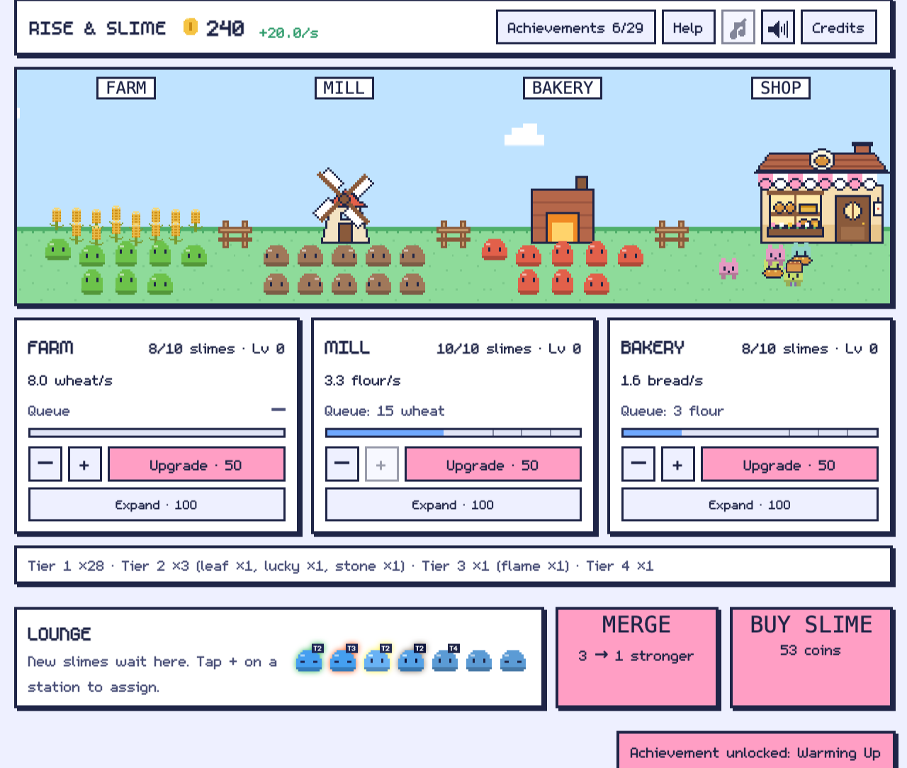
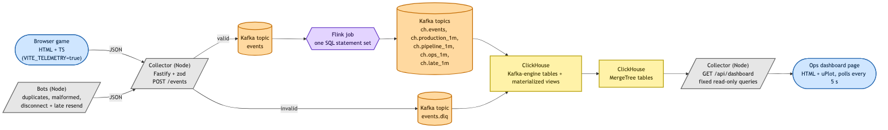
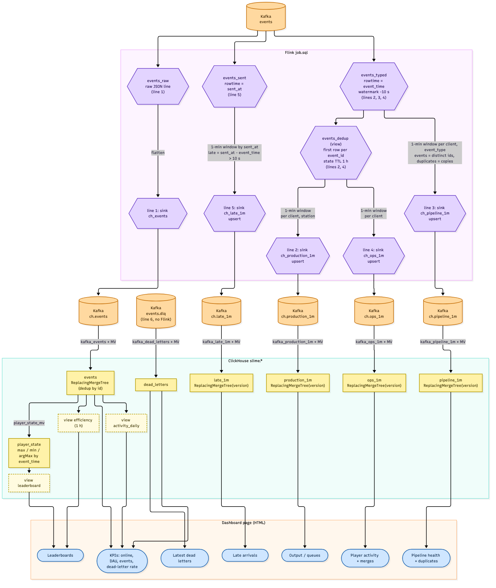

<!--
給其他 bot 的說明(發表前刪除這段):
- 這是 Medium 引流用精簡版草稿,語言 zh-TW,技術名詞保留英文。
- 數字都來自 .claude/PROGRESS.md 的 E2E 對帳紀錄與 docs/pipeline.md;標 [待補] 的地方是還沒有素材(截圖、發表日期)。
- 「待確認」清單在檔案最後,不要把清單內的說法寫成已驗證的事實。
- 圖檔:docs/pipeline-services.png、docs/pipeline-tables.png、itch-media/shot1-main.png(遊戲畫面,demo 狀態);儀表板截圖還沒拍(指令見 docs/system.md)。
- Repo:https://github.com/tses89214/Rise-Slime
-->

# 我做了一款放置遊戲,只為了餵飽一條即時數據管線

> 副標:Kafka → Flink → ClickHouse,處理重複、遲到、壞掉的事件,以及一個我沒預料到的 bug。

我是資料工程師。工作上很難自己決定「資料長什麼樣」,所以我做了一款小遊戲 *Rise & Slime*(史萊姆麵包坊放置遊戲),讓玩家的每個動作都變成一筆事件,送進一條完整的即時管線。遊戲只是水源,重點是管線怎麼面對髒資料。



## 整體架構

```
瀏覽器遊戲 / 模擬玩家 bots
        ↓ JSON
Collector(Python FastAPI,JSON Schema 驗證)
   ├─ 合格 → Kafka  events
   └─ 不合格 → Kafka  events.dlq(dead letter,不丟棄)
        ↓
Flink SQL(去重、1 分鐘視窗、遲到事件)
        ↓ upsert topics
ClickHouse(ReplacingMergeTree)
        ↓
自製 HTML 儀表板(uPlot)
```



遊戲本身是純 TypeScript、不依賴畫面,所以同一份規則可以在 Node 裡跑成 bots,不用開瀏覽器就能產生大量玩家。

## 我故意讓資料變髒

真實的資料管線不會收到乾淨的資料,所以我讓 bots 主動製造問題:

- **重複事件**:約 1% 的事件送兩次。Flink 依 `event_id` 去重(state 保留 1 小時)。
- **格式錯誤的事件**:進 dead-letter topic,同時記下錯誤原因,儀表板會顯示最新幾筆。
- **斷線再補送**:bot 暫存事件、事後一次送出,於是事件「遲到」。視窗允許 15 分鐘的遲到,遲到的事件會讓該視窗重新計算並以 upsert 覆寫。
- **schema 演進**:v1 與 v2 的事件同時存在,同一條管線都能處理。



## 怎麼知道算對了?

我沒有只看儀表板「看起來合理」,而是拿 ClickHouse 的原始事件表(`events FINAL`)逐分鐘對帳 Flink 算出來的視窗。

做法:2026-11-04 先 `docker compose down -v` 把 Kafka 與 ClickHouse 的資料全部清掉,重新啟動並提交 Flink job,再即時(`--speed 1`)跑一輪 20 個 bots × 600 秒(重複事件 1%、格式錯誤 0.5%、斷線 2% 為預設值),等 2 分鐘讓 Flink 跟上。結果(共 3,998 筆事件、11 個分鐘;最後一個分鐘的視窗在 run 結束時還沒關閉,不會輸出,所以比對 10 個已輸出的視窗):

- 10 個視窗,**0 個不一致**。事件數:視窗加總 3,886 = 原始表同分鐘的不重複事件 3,886。
- 麵包銷售量(`bread_sold`):34,299 = 34,299。
- **各站產量逐站對帳**:30 列(10 視窗 × farm / mill / bakery),`produced` 291,510 = 291,510、`consumed` 207,620 = 207,620、玩家數也相同,0 個不一致。
- 沒有任何一個原始事件所在的分鐘「完全沒有視窗」(沒有被默默丟掉的整個視窗)。
- 重複事件:Flink 在這 10 個視窗內計到 45 筆重複(約 1.2%),bots 的注入率是 1%;樣本小,波動正常。
- schema 全是 v2(清資料後沒有 v1)。
- Dead letters 18 筆,錯誤全是 `unknown event_type`,與 0.5% 的格式錯誤注入率(約 20 筆)數量級相符;我沒有逐筆比對。
- 這一輪的 20 個 bots 是 10 個 optimizer、5 個 random_assigner、5 個 quitter。

這一輪的限制:600 秒太短,bots 到最後兩分鐘才開始合成(9 個合成、1 個擴充,全落在最後兩個分鐘),已輸出的視窗裡只有 3 個合成、0 個擴充(3 = 3、0 = 0),所以**合成與擴充的對帳樣本很小**;遲到事件的功能(`late_1m`)這一輪也沒觸發(0 筆),因為這次沒有斷線到足以產生遲到。

注意:最後一個還沒關閉的視窗,要等後面的事件把 watermark 往前推才會輸出,所以對帳時要排除最新的那一分鐘。

## 我踩到的一個坑:誰的時鐘可信?

Flink 的視窗與 watermark 用的是事件裡的 `event_time`,而這個時間是**客戶端自己填的**。讀程式碼時我發現一個推論(**尚未實測**):只要有一筆事件的時間比其他玩家快很多,watermark 就會被推到未來,其他玩家超過 15 分鐘 allowed lateness 的事件會被視窗默默丟掉,不進 dead letter,也看不到。

我的處理是在 collector 加一道檢查:瀏覽器端的 `event_time` 與收件時間差超過 10 分鐘就進 DLQ(bots 豁免,因為 fast-forward 與斷線暫存本來就合法)。這是權宜之計:`client` 欄位本身可以偽造,而且 10 分鐘對休眠中的分頁是否太緊,我也還沒驗證。比較根本的做法是改用 collector 自己蓋的 `ingested_at`,那是唯一可信的時鐘。

## 讓假玩家不要長得一模一樣

第一版的 bots 有三種 persona,但同一種 persona 的 bot 完全一樣:`optimizer` 的決策沒有用到任何亂數。儀表板的「最富有玩家」排行榜上,5 個 optimizer 的數字一模一樣:4,123 金幣、38 隻史萊姆、138 級。這種資料拿來看分佈、看排名、看離群值都沒意義。

我給每個 bot 加了依 seed 決定的「脾氣」:每秒有多大機率動作(0.4 到 1.0),以及 optimizer 買史萊姆和擴充時的耐心(1 到 2.5 倍)。用獨立的亂數流,原本的遊戲亂數不受影響,舊 seed 的行為不變。改完後同樣是 optimizer,金幣從 264 到 1,004 都有(20 個 bots、600 秒、`--speed 20` 的一輪,排行榜前幾名的觀察值,不是統計結果)。我也加了一個測試:5 個不同 seed 的 optimizer 跑 600 秒,結果至少要有 4 種不同的「金幣/史萊姆數」,以免之後有人把這個隨機性改回去。

## 為了寫 Help 才發現的規則 bug

玩家問我「lucky 史萊姆是幹嘛的」,我去寫 Help 時才讀到:lucky 的設計是「合成時變異機率翻倍」。但實際上程式只有在「三個材料都沒有 trait」時才擲變異的骰子,而 lucky 本身就是一個 trait,所以只要材料裡有 lucky,骰子就不會被用到,「翻倍」永遠沒有效果。事件裡記錄的 `mutation_chance: 0.1` 其實是假的。測試只驗了機率的數字,沒驗有沒有真的變異。

修法是每次合成都擲骰子,成功就給隨機 trait,失敗才繼承。新增的測試用 7% 的骰值:有 lucky 會變異、沒有 lucky 不會。

這件事對資料管線也有教訓:`slime_merged.mutated` 的語意變了,但 `schema_version` 沒有跟著動(欄位的型別沒變,只有意義變了)。舊資料與新資料在 ClickHouse 裡並存,跨日期比較變異率時要自己知道這件事。schema 版本管不到「語意漂移」。

另一個類似的發現:合成原本會把正在工作的史萊姆從工作站抽走去湊 3 隻。玩家的 FARM 產出會莫名掉下來,卻沒有任何提示。改成只用 Lounge 裡的史萊姆。這個改動又讓 optimizer bot 壞掉:它原本一有空位就擴充,Lounge 永遠湊不到 3 隻,所以一次都不合成,而且只擴充 farm(跑 7200 秒會變成 farm 48 個、mill 10 個、bakery 10 個)。我讓它擴充「離理想比例最遠」的站,並且等 Lounge 湊滿 3 隻再決定要合成還是擴充。

## 上架 itch.io 時踩的兩個坑

- **絕對路徑**:本機開發時資源是 `/fonts/…`、`/original/…`、`/audio/…`,放到 itch.io 會 404,因為遊戲被放在 `html.itch.zone/html/<id>/` 這種子路徑下。我改成相對路徑並設 `base: './'`,再把 build 放進本機伺服器的子路徑,逐一檢查 16 個資源都是 200。上線後我在 itch.io 上實際玩過,可以正常執行。
- **全新環境的啟動順序**:`down -v` 後 `events` 這個 topic 還不存在(要等 collector 第一次寫入才會自動建立),但文件的順序是先提交 Flink job,job 讀不到 topic 就一直 RESTARTING。這是我為了拿到乾淨的對帳數字,清資料重跑時才遇到的。現在 README 在提交 job 前先建好 topic。

兩個坑的共同點:它們都在「我自己的機器上一直沒問題」,因為舊的狀態(舊資料、已存在的 topic、根路徑)把問題蓋住了。

## 這個專案教我的事

- Kafka、Flink、ClickHouse 各自的「正確」是不同層次的:Kafka 保證順序與不遺失,Flink 負責時間語意,ClickHouse 負責最終一致的查詢。把「去重」放在哪一層,是設計時最花時間想的事。
- 「不要靜默丟資料」要落實到每一個邊界,包含 HTTP 層與視窗層。我目前仍有缺口(見下方限制)。
- 可以自己造資料的專案,最大的好處是能**故意製造問題再驗證**,而不是等真實資料出事。

## 已知限制

- 瀏覽器端事件送出失敗時沒有重試或暫存,collector 或 Kafka 掛掉會遺失事件(只有 bots 有斷線暫存)。
- collector 收到不是 JSON 的 body 時回 400,沒有進 DLQ,與「無效事件不靜默丟棄」的原則不一致。
- 超過 15 分鐘 allowed lateness 的事件,Flink 不會修正(原始 `events` 表仍保有)。

## 試試看

Repo:https://github.com/tses89214/Rise-Slime
README 有「只玩遊戲」與「跑完整管線」兩種啟動方式。

試玩(瀏覽器直接玩):https://tses89214.itch.io/rise-slime

---

<!--
待確認清單(寫成已驗證事實前要先確認):
1. 對帳數字是 2026-11-04 `down -v` 後單次乾淨跑(20 bots × 600 s,即時)查出來的。查詢是 ClickHouse 的 JOIN:視窗表 FINAL 對 `events FINAL` 的同分鐘彙總,涵蓋事件數、bread_sold、各站 produced / consumed / 玩家數、合成、擴充。尚未驗證:長時間跑(合成與擴充樣本太小)、遲到事件(`late_1m` 這輪 0 筆)、斷線補送的路徑、`avg` 類欄位(slimes、input_stock)。
2. 「watermark 被推到未來會丟其他玩家事件」:PROGRESS 標為「學習時讀碼發現,未實測」,文章已照樣標明。
3. Dead letters 18 筆全是 `unknown event_type`,與 0.5% 注入率的預期數量相近,但沒有逐筆比對,文章沒有寫成「等於注入數量」。
4. 遊戲截圖用的是 demo 狀態(金幣、史萊姆數是手設的),不是真實進度;儀表板截圖尚未拍。
5. 遊戲英文名撞名:只做過網路搜尋(沒有同名,最近的是 Rise of the Slime),未查 itch.io / Steam 站內搜尋。itch.io 已上線,頁面由作者本人確認可玩。
6. 「optimizer 從 264 到 1,004 金幣」是一次 20 bots × 600 秒的觀察,該輪資料已在後續 `down -v` 時清掉,無法重查;文章已標明不是統計結果。「5 個 optimizer 一模一樣」的數字是作者從儀表板貼給我的。
7. 「mutated 語意變了但 schema_version 沒升」:這是我的判斷,實際沒有升版本;是否該升版本是設計取捨。
-->
