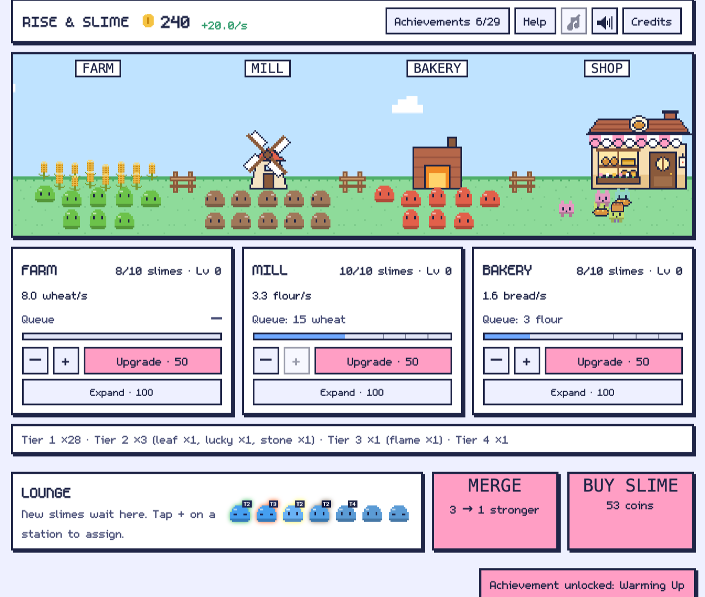
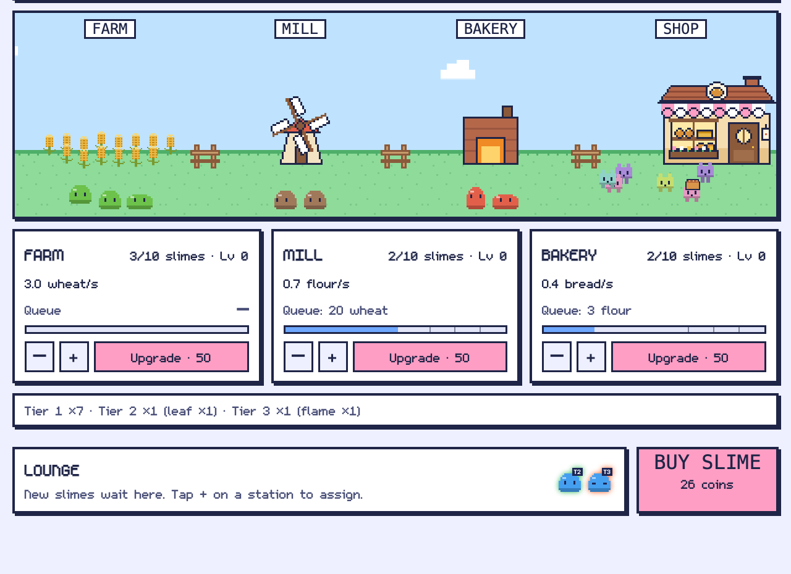

<!--
給其他 bot 的說明(發表前刪除這段):
- 第 1 篇:介紹遊戲 Rise & Slime。讀者是一般玩家與獨立遊戲愛好者,不要寫 Kafka / Flink 細節,只在結尾導到第 2 篇。
- zh-TW。圖檔:itch-media/shot1-main.png、shot3-early.png、shot2-help.png、cover-630x500.png(都是 demo 狀態,金幣與史萊姆數是手設的)。
- 數字來自程式:佇列/升級/合成規則見 src/core/sim.ts 與遊戲內 Help。離線上限 8 小時來自 CLAUDE.md,沒重新實測,文章沒寫。
- 試玩:https://tses89214.itch.io/rise-slime  Repo:https://github.com/tses89214/Rise-Slime
- 第 2 篇連結發表後補:[待補:第 2 篇網址]
-->

# Rise & Slime:一款關於史萊姆麵包坊的小型放置遊戲

**試玩(瀏覽器直接玩,免費):https://tses89214.itch.io/rise-slime**

你經營一間麵包坊,員工是一群圓滾滾的史萊姆。你不用一直點,只要把牠們放到對的位置,看數字慢慢長大。

## 一條很短的生產線

- **Farm**:每隻史萊姆每秒種出 1 份小麥。
- **Mill**:每隻史萊姆把 2 份小麥磨成 1 份麵粉。
- **Bakery**:每隻史萊姆把 2 份麵粉烤成 1 條麵包。
- **Shop**:每條麵包賣 10 金幣,史萊姆顧客會真的跑來店門口買。

一個站得等前一個站供料才會開工,所以不是塞越多越好。每個站有一條「佇列條」,顏色會告訴你原料是不夠(飢餓)、剛好、開始堆積,還是已經卡住。遊戲裡的提示是:大約 4 : 6 : 5 的人數比例,能讓三個站都忙起來。

## 賺到的錢怎麼花

- **買新史萊姆**,先放在 Lounge,再派到站上。
- **升級工作站**:每級快 10%,到第 10、25、50 級速度再翻倍。
- **擴充名額**:每個站一開始 10 個位子,滿了可以花錢加。

## 合成與特性

玩到一段時間會解鎖**合成**:把 Lounge 裡 3 隻同階的史萊姆合成 1 隻高一階的。這是個有取捨的決定,3 隻換 1 隻,總產量約少 17%,但能空出 2 個位子。

合成時有機會讓史萊姆**變異**出特性,會發出不同顏色的光:

- **Leaf**:在 Farm 特別強,在 Bakery 變弱。
- **Stone**:在 Mill 特別強,在 Farm 變弱。
- **Flame**:在 Bakery 特別強,在 Mill 變弱。
- **Lucky**:沒有加成也沒有減益,但帶著它合成,變異機率會翻倍。

每種特性都在某個地方吃虧,所以「誰放哪一站」是個小小的配置問題。

## 一些做法

- 畫面全部是原創像素美術,用腳本產生,字型和音樂、音效是 CC0 素材,都列在 CREDITS 裡。
- 遊戲裡有成就、成就解鎖的提示,以及一個 Help 按鈕講完整規則。
- 程式是開源的(MIT)。

## 給好奇的人

這款遊戲其實還有另一個身分:它的每個動作都會變成一筆事件,送進一條即時資料管線(Kafka、Flink、ClickHouse)。上架到 itch.io 的版本不含任何事件傳送程式碼。管線那一側我另外寫了一篇:[待補:第 2 篇網址]。

- 試玩:https://tses89214.itch.io/rise-slime
- 原始碼:https://github.com/tses89214/Rise-Slime
