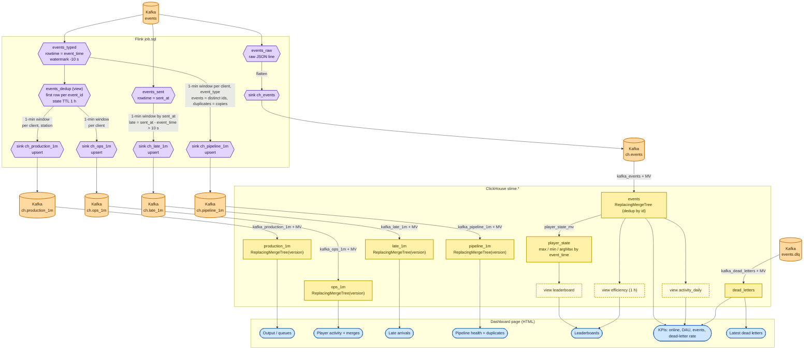

# Data pipeline map

How an event travels from a player's click to a dashboard chart. Source of truth for the SQL is
`pipeline/flink/job.sql` and `pipeline/clickhouse/init.sql`; this page explains how the pieces connect.

Rendered copies (regenerate with `npx @mermaid-js/mermaid-cli` if you edit the diagrams): [services](pipeline-services.png), [tables](pipeline-tables.png).

## Legend (both diagrams use the same shapes and colours)

| Technology | Shape | Colour |
| --- | --- | --- |
| Kafka topic | cylinder | orange |
| Flink (job, source / sink tables, view) | hexagon | purple |
| ClickHouse table / Kafka-engine table | rectangle | yellow |
| ClickHouse view | rectangle, dashed border | light yellow |
| HTML / browser (game page, dashboard page) | rounded pill | blue |
| Node service (collector, bots) | rectangle with slanted edges | grey |

## 1. Services (who talks to whom)

```mermaid
flowchart LR
  classDef kafka fill:#FFD9A0,stroke:#C26A00,color:#3a2200,stroke-width:2px
  classDef flink fill:#E3D4FF,stroke:#6A3DC8,color:#22104d,stroke-width:2px
  classDef ch fill:#FFF2A8,stroke:#B39B00,color:#3b3300,stroke-width:2px
  classDef html fill:#CFE6FF,stroke:#2F6FB5,color:#0d2a4a,stroke-width:2px
  classDef node fill:#E6E6E6,stroke:#666,color:#222,stroke-width:2px

  game(["Browser game<br/>HTML + TS<br/>(VITE_TELEMETRY=true)"]):::html
  bots[/"Bots (Node)<br/>duplicates, malformed,<br/>disconnect + late resend"/]:::node
  collector[/"Collector (Node)<br/>Fastify + zod<br/>POST /events"/]:::node

  t_events[("Kafka topic<br/>events")]:::kafka
  t_dlq[("Kafka topic<br/>events.dlq")]:::kafka
  t_ch[("Kafka topics<br/>ch.events, ch.production_1m,<br/>ch.pipeline_1m, ch.ops_1m,<br/>ch.late_1m")]:::kafka

  flink{{"Flink job<br/>one SQL statement set"}}:::flink

  chk["ClickHouse<br/>Kafka-engine tables + materialized views"]:::ch
  store["ClickHouse<br/>MergeTree tables"]:::ch

  api[/"Collector (Node)<br/>GET /api/dashboard<br/>fixed read-only queries"/]:::node
  dash(["Ops dashboard page<br/>HTML + uPlot, polls every 5 s"]):::html

  game -->|JSON| collector
  bots -->|JSON| collector
  collector -->|valid| t_events
  collector -->|invalid| t_dlq
  t_events --> flink
  flink --> t_ch
  t_ch --> chk
  t_dlq --> chk
  chk --> store
  store --> api
  api --> dash
```

- The collector is the only writer to Kafka from the outside. A schema-invalid event is never dropped: it goes to `events.dlq` with the error.
- Flink reads only `events` (valid events). Dead letters skip Flink: ClickHouse reads `events.dlq` directly.
- Flink never writes ClickHouse directly. It writes `ch.*` topics and ClickHouse's Kafka engine loads them, so a ClickHouse outage does not stall Flink (the topics buffer).

## 2. Tables (what feeds what)

## 3. Why it is built this way

| Problem | Where it is handled |
| --- | --- |
| Bot/network resends the same event | `events_dedup` in Flink (counts and sums); `ReplacingMergeTree` on `events` (raw store). `pipeline_1m.duplicates` counts the copies. |
| Event arrives after its window closed (client was offline) | Flink `allow-lateness 15 min` + late-fire: the window is re-emitted with the new total. The sinks are `upsert-kafka`; ClickHouse keeps the row with the highest `version` (= rows in the window, which only grows). Read these tables with `FINAL`. |
| How many events were late? | `late_1m`: windowed by `sent_at`, because late rows are the ones event-time windows would otherwise hide. |
| Malformed event | Collector zod check -> `events.dlq` -> `dead_letters`. |
| Old clients (schema v1) and new (v2) at once | v2 only adds events and optional fields; `payload` keeps the full JSON in `events`, so new event types need no DDL. |
| Leaderboard needs "latest state" | `player_state` merges idempotently, so duplicate or reordered events change nothing. |

## 4. Operating notes

- Start order: `docker compose up -d`, collector, bots, then `docker compose --profile submit run --rm flink-sql`.
- Editing `job.sql` and resubmitting: `scripts/flink-restart.sh` stops the running job with a savepoint and starts the new one from it, so Kafka is not replayed (checked: `ch.events` end offset unchanged). If the change is not savepoint-compatible, cancel the job and run `docker compose --profile submit run --rm flink-sql`: that replays all of Kafka (the versioned tables absorb it, `events` collapses duplicates at merge, but windows older than the allowed lateness are dropped).
- Checkpoints run every 10 s into the `flink-state` volume.
- Deleting a Kafka topic that a ClickHouse Kafka table reads leaves that consumer stale. Drop and recreate the `kafka_*` table and its MV, and reset the group offset if needed (`kafka-consumer-groups.sh --reset-offsets`).
- Windows still open at the end of a run (no later event pushes the watermark past them) are not emitted yet: compare totals excluding the newest minute.
